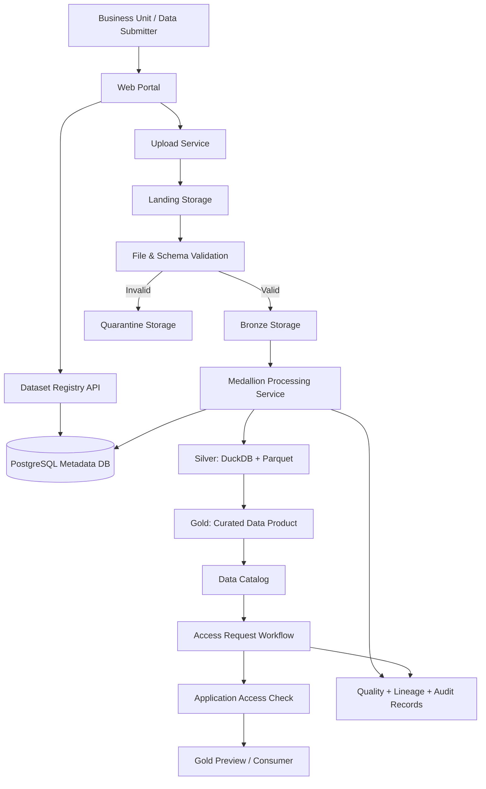
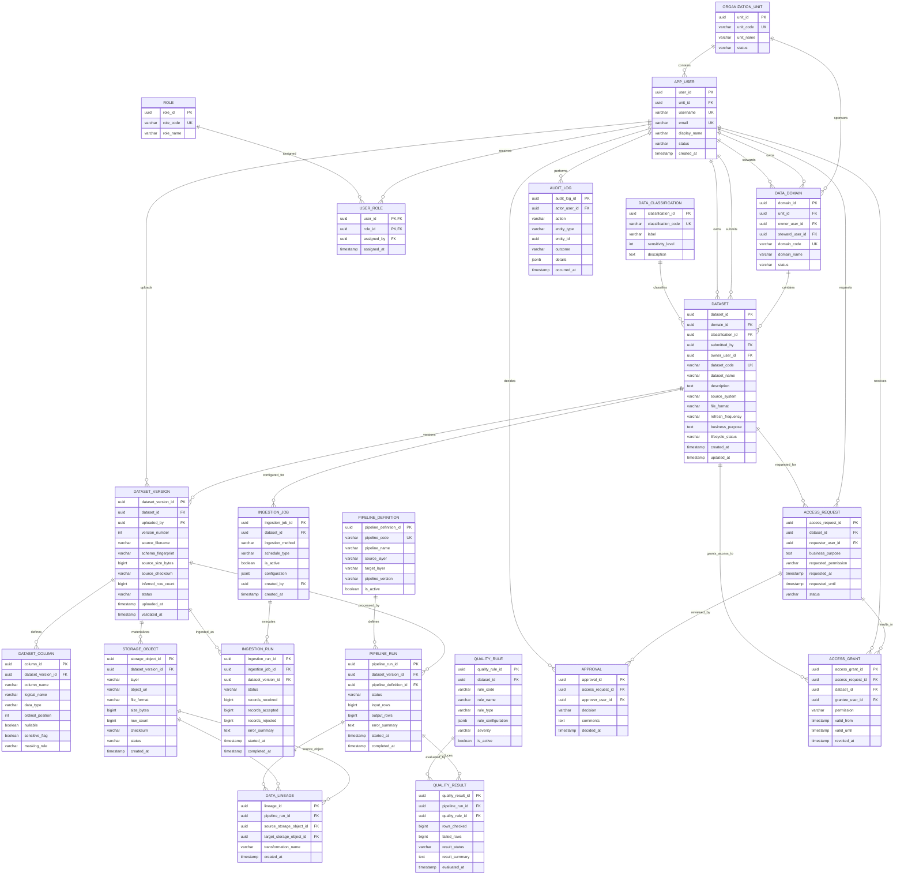

# Banking Enterprise Data Lakehouse Simulator
## Product Requirements Document (Personal Project / MVP)

**Document status:** Draft — Personal Build  
**Project type:** Portfolio / hands-on engineering project  
**Target builder:** 1 developer  
**Suggested effort:** 6 milestones, worked through in spare time  
**Version:** 1.0

---

## 1. Executive Summary

Banking Enterprise Data Lakehouse Simulator is a small, locally runnable application that demonstrates how multiple business units can submit datasets to a shared data platform, how a central data team can process them through a Medallion Architecture, and how approved consumers can discover and request access to curated Gold datasets.

The project is inspired by the enterprise data platform concept discussed for a banking environment such as BNI. It is **not an official BNI system, not a production-ready banking platform, and not connected to BNI infrastructure**. Use synthetic or public non-sensitive data only. Never upload real customer, employee, account, transaction, credit, credential, or confidential bank data.

The project intentionally focuses on the core workflow rather than enterprise-scale infrastructure:

1. A business unit registers and submits a dataset.
2. The platform records metadata and stores the uploaded source file.
3. The central data team validates and processes the dataset.
4. The application creates Bronze, Silver, and Gold outputs.
5. A data catalog exposes published Gold datasets and their metadata.
6. A consumer submits an access request; a simulated approver approves or rejects it.
7. The app records lineage, data-quality results, and audit events.

### Product proposition

**One governed entry point for data submission, one managed processing workflow, and reusable curated data products.**

---

## 2. Problem Statement

In a multi-unit organization, datasets are often distributed across different teams, systems, file formats, and naming conventions. Analytics teams may spend repeated effort finding data, understanding its meaning, reconciling inconsistent schemas, and checking whether it is safe and approved for reuse.

This project demonstrates a lightweight pattern for reducing that friction:

- Give data-producing teams a standard submission workflow.
- Keep source ownership and business meaning with the source domain.
- Centralize technical ingestion, validation, transformation, and publication.
- Make curated datasets discoverable through a catalog.
- Record who submitted, processed, approved, and accessed each dataset.

### Assumptions to validate in a real organization

- Existing data platforms, catalogues, MDM, IAM, and governance services may already cover some capabilities.
- The real source systems, data classifications, legal basis, retention rules, and approval paths must be confirmed by the organization.
- The personal project uses mock identities and simplified controls; it does not establish regulatory compliance.

---

## 3. Goals and Non-Goals

### 3.1 Goals

| ID | Goal | MVP success evidence |
|---|---|---|
| G1 | Enable unit-level dataset registration | A user can register a dataset with owner, domain, classification, format, and refresh frequency. |
| G2 | Support controlled file submission | CSV and JSON files can be uploaded and linked to a dataset version. |
| G3 | Demonstrate Medallion processing | A successful run creates Bronze, Silver, and Gold outputs. |
| G4 | Make Gold discoverable | Published Gold datasets appear in a catalog with descriptions and quality status. |
| G5 | Demonstrate governed access | A consumer can request access and an authorized demo approver can decide. |
| G6 | Provide traceability | Dataset versions, pipeline runs, lineage, quality results, and audit events are recorded. |
| G7 | Run locally at low cost | The application can be run on a developer laptop using Docker Compose and open-source tools. |

### 3.2 Non-Goals for MVP

- Connecting to real BNI systems, networks, databases, or credentials.
- Ingesting production customer or employee information.
- Building a distributed, highly available enterprise data platform.
- Deploying Kafka, Spark clusters, Kubernetes, or a multi-node object-storage cluster.
- Implementing real enterprise SSO, HSM/KMS integration, DLP, or a production-grade policy engine.
- Implementing a full Master Data Management solution or customer 360 matching.
- Supporting arbitrary user-written SQL transformations in the UI.
- Providing regulatory certification or claiming compliance with POJK, SEOJK, UU PDP, or bank secrecy requirements.

These may be future extensions after the core workflow works.

---

## 4. Target Users and Roles

The MVP simulates five roles. Authentication can be mocked for the demo; the role checks should still be enforced in the application service layer.

| Role | Main capabilities |
|---|---|
| Data Submitter | Register datasets for their unit, upload new versions, view submission and processing status. |
| Data Steward | Review dataset metadata, verify schema/definition, inspect data-quality results, recommend publication. |
| Platform Admin | Manage demo domains, users, ingestion jobs, pipeline runs, and operational status. |
| Security Reviewer | Review classification and access requests; approve or reject access in the demo. |
| Central Data Consumer | Browse published Gold datasets, inspect metadata/lineage, and request access. |

### Role boundaries

- A submitter can manage only datasets associated with their demo organizational unit, unless explicitly granted otherwise.
- A steward reviews metadata and quality; a steward does not automatically gain access to every raw row.
- A consumer sees catalogue metadata by default, not unrestricted Bronze/Silver contents.
- An approved access request grants access only to the specified dataset and validity period in this simulation.
- Platform Admin actions must create audit events.

---

## 5. MVP Scope

### 5.1 In Scope

1. Demo login / role switch for seeded users.
2. Organizational unit and data-domain management (seeded initially).
3. Dataset registration and metadata capture.
4. CSV and JSON upload, with a configurable file-size limit.
5. Dataset version tracking.
6. Landing and Bronze raw-file storage.
7. Schema inspection and basic validation.
8. Silver processing using Python, DuckDB, and Parquet.
9. Gold generation using one or two predefined aggregation templates.
10. Basic data-quality rules: required columns, null threshold, data types, duplicate keys, and row counts.
11. Data catalog for published Gold datasets.
12. Dataset-level access request and approval simulation.
13. Basic lineage from source file to Bronze, Silver, and Gold objects.
14. Audit log for key actions.
15. Overview dashboard showing dataset counts, pipeline statuses, quality failures, and pending access requests.

### 5.2 Explicitly Deferred

- CDC from operational databases.
- Streaming ingestion and event processing.
- Scheduling and complex dependency orchestration.
- Fine-grained row-level and column-level enforcement in an external query engine.
- Automated PII detection using machine learning.
- Data contracts shared with real source systems.
- Multi-tenant isolation and enterprise disaster recovery.
- Full MDM, semantic layer, and enterprise DWH integration.

---

## 6. Primary User Journeys

### Journey A — Submit a dataset

1. Submitter signs in using a seeded demo account.
2. Opens **Submit Dataset**.
3. Selects a data domain and enters dataset name, description, business purpose, classification, refresh frequency, and source system label.
4. Uploads a CSV or JSON file.
5. Platform inspects file format, size, headers, encoding, and basic schema.
6. Platform creates a dataset version and stores the original file in Landing.
7. The submitter sees the submission status and generated dataset ID.

### Journey B — Process through Medallion layers

1. Platform Admin or Data Steward opens a submitted dataset version.
2. Reviews the inferred schema and validation summary.
3. Starts the demo processing pipeline.
4. The pipeline preserves the source in Bronze.
5. Silver processing normalizes column names, trims strings, converts configured data types, handles duplicates, and separates rejected rows.
6. Gold processing applies a selected aggregation template.
7. The app records run status, row counts, quality checks, output object locations, and lineage edges.
8. A Steward reviews the result and publishes the Gold data product.

### Journey C — Discover and request access

1. Central Data Consumer opens the Data Catalog.
2. Searches for a published dataset and views its description, owner, classification, update time, schema, and quality status.
3. Requests access, providing a purpose and requested duration.
4. Security Reviewer reviews the request and approves or rejects it.
5. If approved, the application creates an access grant with an expiry date.
6. The consumer can preview a safe, synthetic Gold sample through the application. Every access is audited.

---

## 7. Functional Requirements

Priority scale: **P0** = required for MVP, **P1** = desirable if time permits, **P2** = future work.

| ID | Requirement | Priority | Acceptance criteria |
|---|---|---:|---|
| FR-01 | Demo identity and roles | P0 | Seeded demo users can enter the app with distinct roles; restricted actions are hidden and denied server-side for unauthorized roles. |
| FR-02 | Dataset registration | P0 | User can create a dataset with name, description, domain, source unit, owner, classification, file format, purpose, and refresh frequency. |
| FR-03 | Dataset versioning | P0 | Every upload creates a new immutable dataset version; previous version metadata remains accessible. |
| FR-04 | File upload | P0 | CSV and JSON files are accepted; unsupported formats and files over the configured size limit are rejected with a clear error. |
| FR-05 | Schema inspection | P0 | System records column name, inferred type, ordinal position, and nullability estimate for each version. |
| FR-06 | Bronze persistence | P0 | Original source file is retained unchanged in a Bronze location and linked to the dataset version. |
| FR-07 | Silver transformation | P0 | The pipeline normalizes column names and whitespace, applies configured type conversions, and records rejected rows. |
| FR-08 | Gold generation | P0 | At least one approved aggregation template produces a Gold Parquet dataset from Silver data. |
| FR-09 | Data-quality checks | P0 | Required-column, type, null, duplicate, and row-count checks produce persisted pass/fail results. |
| FR-10 | Pipeline run tracking | P0 | Each run has a status, start/end time, input/output row counts, and error summary. |
| FR-11 | Data catalog | P0 | Consumers can search published Gold datasets and see metadata without seeing raw data. |
| FR-12 | Access request workflow | P0 | Consumer can request access; reviewer can approve or reject; approved requests create time-bound grants. |
| FR-13 | Application-level access check | P0 | Gold preview is available only to the owner/steward or a consumer with a valid grant. |
| FR-14 | Data lineage | P0 | User can view the source-to-Bronze-to-Silver-to-Gold relationship for each processed dataset version. |
| FR-15 | Audit events | P0 | Dataset registration, upload, processing, publication, access request, decision, and data preview produce audit events. |
| FR-16 | Overview dashboard | P1 | Dashboard displays total datasets, layer counts, failed runs, quality failures, and pending requests. |
| FR-17 | Metadata export | P1 | Platform Admin can export catalogue metadata as CSV or JSON without exporting protected dataset contents. |
| FR-18 | Scheduled ingestion | P2 | A registered ingestion job can execute at a configured schedule. |

---

## 8. Proposed System Architecture

### 8.1 Logical flow



### 8.2 Recommended personal-project stack

| Layer | Technology | Why it fits the personal MVP |
|---|---|---|
| Frontend | Streamlit | Fast to build forms, tables, and operational dashboards. |
| Backend API | FastAPI | Clear API boundary and typed request/response models. |
| Metadata database | PostgreSQL | Relational integrity for datasets, versions, users, access requests, and audit metadata. |
| Local data storage | Local filesystem initially; MinIO optional later | Easy local setup; preserves separation between metadata and data files. |
| Processing | DuckDB + PyArrow + Pandas | Runs locally and handles CSV/Parquet transformations without a Spark cluster. |
| Data format | Parquet | Columnar storage for analytical datasets. |
| Containerization | Docker Compose | Repeatable local setup for app and PostgreSQL. |
| Tests | Pytest | Unit and API tests. |
| Charts | Plotly | Dashboard visualizations. |

**Do not add Kafka, Spark, Kubernetes, Airflow, or a distributed object store in the first version.** They increase setup and operational overhead without proving the core product workflow. Add them only when a concrete requirement justifies them.

### 8.3 Separation of metadata and data

- PostgreSQL stores metadata and workflow state only.
- The filesystem / object storage stores actual source and processed files.
- Database rows store object URIs, checksums, sizes, and row counts, not the complete dataset contents.
- Never store secrets or raw credentials in metadata JSON fields.

Suggested local directory layout:

```text
storage/
  landing/<domain>/<dataset_id>/<version>/source.csv
  bronze/<domain>/<dataset_id>/<version>/source.parquet
  silver/<domain>/<dataset_id>/<version>/part-*.parquet
  gold/<domain>/<dataset_id>/<version>/part-*.parquet
  quarantine/<domain>/<dataset_id>/<version>/rejected.parquet
```

Use generated IDs in physical paths rather than user-provided filenames. Validate paths to prevent traversal. Treat the directory structure as a local implementation detail; the database stores the canonical object URI.

---

## 9. ERD — Metadata and Control Plane

The ERD below models the platform's **metadata and workflow database**, not the business records stored in Bronze, Silver, or Gold. This distinction is important: the actual banking-like data lives in files/tables in the data lake; PostgreSQL manages who owns it, where it is, what happened to it, and who may access it.

### 9.1 ERD (Mermaid)



### 9.2 Entity purpose and relationship summary

| Entity | Purpose | Key relationship |
|---|---|---|
| ORGANIZATION_UNIT | Demo directorate/division/team registry | One unit has many users and data domains. |
| APP_USER | Demo identities for submitter, steward, reviewer, and consumer | Belongs to one unit; receives roles and performs actions. |
| ROLE / USER_ROLE | Role-based access for the application | Many-to-many between users and roles. |
| DATA_DOMAIN | Business grouping such as Retail, Lending, Finance, or HR | Has one owner and one steward; contains datasets. |
| DATA_CLASSIFICATION | Controlled classification vocabulary | One classification can apply to many datasets. |
| DATASET | Logical data product registration | Belongs to a domain; has versions, jobs, and access requests. |
| DATASET_VERSION | Immutable submitted version and inferred schema snapshot | One dataset has many versions. |
| DATASET_COLUMN | Column-level schema metadata for one version | One version has many columns. |
| STORAGE_OBJECT | Physical file/table reference for Landing, Bronze, Silver, Gold, or Quarantine | One version can materialize into multiple objects/layers. |
| INGESTION_JOB / INGESTION_RUN | Ingestion configuration and execution history | One job has many runs; each run relates to a submitted version. |
| PIPELINE_DEFINITION / PIPELINE_RUN | Reusable transformation definition and individual execution | One definition has many runs. |
| QUALITY_RULE / QUALITY_RESULT | Configured checks and their execution results | A pipeline run evaluates multiple rules. |
| DATA_LINEAGE | Directed relationship from one storage object to another | Connects source and target objects created by a pipeline run. |
| ACCESS_REQUEST | Consumer request for a dataset | One request can have multiple approval records and result in a grant. |
| APPROVAL | Individual approval/rejection decision | Belongs to one access request and one approver. |
| ACCESS_GRANT | Time-bound permission issued after approval | Links a request, dataset, and grantee. |
| AUDIT_LOG | Append-only record of important actions | Records the actor and affected entity. |

### 9.3 Important database constraints

Implement these constraints in PostgreSQL, not only in frontend validation:

- `organization_unit.unit_code`, `app_user.username`, `app_user.email`, `role.role_code`, `data_domain.domain_code`, and `dataset.dataset_code` must be unique.
- `user_role` must have a composite primary key `(user_id, role_id)`.
- `dataset_version` must have a unique constraint on `(dataset_id, version_number)`.
- `dataset_column` must have a unique constraint on `(dataset_version_id, column_name)` and `(dataset_version_id, ordinal_position)`.
- `storage_object.object_uri` should be unique.
- `access_grant.valid_until` must be later than `valid_from`; expired or revoked grants must not authorize preview.
- A grant can be created only from an approved access request.
- A published dataset must have at least one successful Gold storage object and a completed quality assessment.
- `DATA_LINEAGE.source_storage_object_id` and `target_storage_object_id` must not be equal.
- Audit logs should not be updated or deleted through normal application functions.

### 9.4 Design decisions

1. **Metadata database is not the data lake.** Do not put all uploaded business rows into PostgreSQL.
2. **Dataset and dataset version are separate.** A dataset is a logical asset; each upload is an immutable version.
3. **Storage object represents a physical output.** One dataset version may have Landing, Bronze, Silver, Gold, and Quarantine objects.
4. **Lineage is object-to-object.** This makes it possible to show the actual transformation path between files/tables.
5. **Access is time-bound.** An approval is a decision; a grant is the resulting permission.
6. **Classification belongs to the dataset in MVP.** Column sensitivity is recorded in `dataset_column`; per-column policy enforcement is future work.
7. **The ERD intentionally omits transaction/customer business tables.** Those belong in lakehouse data files, not in the metadata control plane.

---

## 10. Medallion Processing Specification

### 10.1 Landing

Purpose: temporary controlled receipt area before accepting the file into the raw layer.

Checks:
- File extension and detected content type.
- File size limit.
- File encoding and parseability.
- Filename/path sanitization.
- Basic malware scanning is a production requirement; for this local MVP, document that it is not implemented and do not accept executable files.

### 10.2 Bronze

Purpose: preserve the submitted source as received.

Rules:
- Keep the original file unchanged.
- Generate a checksum (SHA-256).
- Record upload timestamp, user, dataset ID, version, and source filename.
- Store a parsed Parquet copy only as an additional representation; never overwrite the original source.

### 10.3 Silver

Purpose: make data technically consistent and usable.

MVP transformations:
- Normalize column names to lowercase `snake_case`.
- Trim leading/trailing whitespace in string values.
- Convert only explicitly configured types; do not silently guess risky financial types.
- Normalize dates to ISO-8601 representation and retain timezone assumptions in metadata.
- Detect duplicates using a configured key, where available.
- Separate rejected rows and record rejection reasons.
- Preserve source columns or mapping metadata so transformations remain traceable.

### 10.4 Gold

Purpose: create a business-ready, documented data product.

For MVP, support predefined templates instead of arbitrary SQL:

- **Branch performance summary:** group by reporting date, region, branch, and product category; calculate record count and aggregate amount.
- **Monthly portfolio summary:** group by reporting month, product category, and region; calculate record count and aggregate balance.

Gold output requirements:
- Has a business description and owner.
- Has a documented grain (what one row represents).
- Has an update timestamp and source version.
- Has quality results attached.
- Is published only after steward review.

### 10.5 Quarantine

Invalid files or rejected rows must be isolated from published Gold outputs. Store rejection reason and run reference. Do not silently drop invalid rows.

---

## 11. Data Quality Rules

Initial quality rules:

| Rule | Description | MVP result |
|---|---|---|
| Required columns | Required columns exist in the submitted schema | Pass / Fail |
| Type conformance | Values can be converted to configured types | Pass / Fail with rejected-row count |
| Null threshold | Required field null percentage is below configured threshold | Pass / Fail |
| Duplicate key | Configured business key is unique, or duplicates are reported | Pass / Fail / Warning |
| Row-count reconciliation | Input rows = accepted rows + rejected rows | Pass / Fail |
| Non-negative amount | Configured amount field is not negative where the business rule requires it | Pass / Fail / Warning |

A quality score may be displayed as a simple percentage for the demo, but it must not replace rule-level pass/fail results. The scoring formula must be visible and documented.

---

## 12. Access and Governance Workflow

### 12.1 Dataset lifecycle

Suggested dataset states:

```text
DRAFT
  -> SUBMITTED
  -> METADATA_REVIEW
  -> READY_FOR_INGESTION
  -> PROCESSING
  -> READY_FOR_STEWARD_REVIEW
  -> PUBLISHED

Exception states: REJECTED, FAILED, ARCHIVED
```

### 12.2 Access-request states

```text
PENDING
  -> APPROVED -> GRANTED -> EXPIRED
  -> REJECTED

GRANTED -> REVOKED
```

### 12.3 MVP policy rules

- Only demo users with the relevant role can perform each action.
- A consumer must provide a business purpose and end date.
- A reviewer decision must include the reviewer identity and timestamp.
- Approval does not grant indefinite access.
- Every Gold preview must verify ownership/stewardship or a currently valid grant.
- Dataset classification is visible in the catalogue; actual row access is not implied by catalogue visibility.
- The demo must clearly label access controls as application-level simulation, not enterprise IAM enforcement.

---

## 13. API Contract (MVP)

Base path: `/api/v1`

| Method | Endpoint | Purpose | Role |
|---|---|---|---|
| GET | `/domains` | List demo data domains | All authenticated demo roles |
| POST | `/datasets` | Register a dataset | Data Submitter, Platform Admin |
| GET | `/datasets` | List datasets visible to the current role | All authenticated demo roles |
| GET | `/datasets/{dataset_id}` | View dataset metadata | Authorized roles |
| POST | `/datasets/{dataset_id}/versions` | Upload a new dataset version | Owner/Submitter, Platform Admin |
| GET | `/datasets/{dataset_id}/versions` | List version history | Owner/Steward, Platform Admin |
| POST | `/versions/{version_id}/validate` | Inspect and validate schema/file | Steward, Platform Admin |
| POST | `/versions/{version_id}/process` | Run Bronze-Silver-Gold demo pipeline | Platform Admin, Data Steward |
| GET | `/runs/{run_id}` | View ingestion/pipeline status | Authorized roles |
| GET | `/catalog` | Search published Gold products | All authenticated demo roles |
| GET | `/datasets/{dataset_id}/lineage` | View dataset lineage | Owner/Steward, approved consumer |
| POST | `/datasets/{dataset_id}/access-requests` | Request dataset access | Central Data Consumer |
| POST | `/access-requests/{request_id}/decision` | Approve/reject request | Security Reviewer, Platform Admin |
| GET | `/datasets/{dataset_id}/preview` | Preview safe Gold rows | Owner/Steward or valid grantee |
| GET | `/dashboard/summary` | Get operational summary | Platform Admin, Data Steward |

### API implementation notes

- Use Pydantic request/response schemas.
- Validate authorization in the backend service, not only in Streamlit navigation.
- Use pagination for list endpoints.
- Do not return local filesystem paths to the client; return logical metadata only.
- Return structured errors with a stable error code and human-readable message.
- Log request IDs and actor IDs for traceability.

---

## 14. Minimal UI Pages

1. **Overview** — dataset counts, processing status, failed runs, quality failures, pending access requests.
2. **Submit Dataset** — registration form and file upload.
3. **My Datasets** — dataset list, version history, and status.
4. **Processing Console** — validation results, run trigger, row counts, quarantine summary.
5. **Data Catalog** — search and inspect published Gold products.
6. **Access Requests** — request access or review pending requests depending on role.
7. **Lineage View** — visualize Landing/Bronze/Silver/Gold object relationships.
8. **Audit Log** — searchable operational events for Platform Admin.

Keep the interface functional and clear; polished enterprise styling is secondary to correct workflow and access checks.

---

## 15. Seed Data and Demo Scenario

Use fully synthetic data generated by the project.

### Demo domains

- Retail Banking
- Lending
- Finance
- Human Capital

### Suggested synthetic datasets

**Dataset A — `branch_transaction_activity`**

| Column | Type | Example |
|---|---|---|
| report_date | date | 2026-01-31 |
| branch_code | string | BR-001 |
| region | string | SUMATERA |
| product_category | string | SAVINGS |
| transaction_count | integer | 1250 |
| transaction_amount | decimal | 250000000.00 |

**Dataset B — `monthly_loan_portfolio`**

| Column | Type | Example |
|---|---|---|
| report_month | date | 2026-01-01 |
| region | string | JAKARTA |
| loan_product | string | SME |
| account_count | integer | 145 |
| outstanding_balance | decimal | 12500000000.00 |

Use no real customer names, account IDs, employee identifiers, phone numbers, addresses, or transaction-level personal information. The sample above is aggregate and fictitious.

### Demo acceptance story

A Retail Banking submitter uploads `branch_transaction_activity.csv`. The system creates version 1, validates the schema, stores the source and Bronze artifact, normalizes and validates the data in Silver, generates a branch/product aggregate in Gold, records quality and lineage, and publishes the Gold product after Steward review. A Central Data Consumer finds it in the catalogue, requests access, receives approval from a Security Reviewer, and previews synthetic aggregate rows. The audit page shows the sequence of events.

---

## 16. Non-Functional Requirements

| Area | MVP requirement |
|---|---|
| Usability | Main workflow should be understandable without reading developer documentation. |
| Performance | A synthetic CSV with up to 100,000 rows should process on a typical laptop; benchmark rather than promise a fixed runtime. |
| Reliability | Failed runs preserve error details and do not publish partial Gold outputs. |
| Data integrity | Dataset versions are immutable; source checksum is stored. |
| Security | No real sensitive data; server-side role checks; safe file handling; secrets in environment variables. |
| Observability | Structured application logs and persisted run status. |
| Portability | Local startup through documented Docker Compose commands. |
| Maintainability | Separate API, services, database models, processing, and UI modules. |
| Testability | Unit tests for transformations and access decisions; API tests for primary workflows. |

---

## 17. Security, Privacy, and Responsible Demo Boundaries

This is an educational prototype, not a compliance implementation. The following controls are required even for a personal demo:

- Use generated synthetic data only.
- Do not connect to internal networks, databases, VPNs, or services.
- Do not commit passwords, API keys, tokens, or `.env` files to Git.
- Validate file type by content where possible, not extension alone.
- Enforce an upload size limit and sanitize filenames.
- Prevent path traversal and unsafe deserialization; do not load arbitrary pickle files.
- Keep the original file immutable and calculate a checksum.
- Restrict dataset preview through backend authorization checks.
- Mask or omit sensitive-looking columns from previews by default.
- Do not expose raw file paths or stack traces in user-facing errors.
- Add a visible disclaimer: “Synthetic demo data only — not for production banking data.”

For any future real-bank implementation, the organization must independently assess applicable banking, privacy, secrecy, cybersecurity, outsourcing, data residency, retention, and audit requirements with its Legal, Compliance, Risk, Data Protection, and Information Security functions. This PRD is not legal advice and does not assert regulatory compliance.

---

## 18. Testing Strategy

### Unit tests

- Column-name normalization.
- Schema inference and required-column validation.
- Type conversion and rejected-row handling.
- Duplicate detection.
- Aggregation output and grain.
- Checksum generation.
- Access grant validity and expiry.
- Role-to-action authorization rules.

### Integration tests

- Dataset registration persists metadata.
- File upload creates a dataset version and Landing object.
- Successful processing creates Bronze, Silver, and Gold objects.
- Failed processing does not publish Gold.
- Quality result and lineage rows are created.
- Approved access request creates a grant.
- Expired/revoked grant blocks Gold preview.
- Each critical workflow writes an audit record.

### End-to-end demo test

Run the complete Demo Scenario in Section 15 from a clean database and confirm that the final Gold dataset is visible to a consumer only after approval.

---

## 19. Delivery Roadmap for Spare-Time Development

Work milestone by milestone. Do not move to the next milestone until the previous one has a working demo and basic tests.

| Milestone | Build | Definition of done |
|---|---|---|
| 1. Foundation | Repo, Docker Compose, PostgreSQL, FastAPI, Streamlit shell, seed data | App starts locally; database migrations run; demo user can open the UI. |
| 2. Metadata & ERD | SQLAlchemy models/migrations for units, users, roles, domains, datasets, versions, classifications | Dataset can be registered and viewed; constraints are tested. |
| 3. Submission | Upload service, Landing storage, checksum, schema inspection, Bronze object | CSV/JSON upload creates a version and Bronze/metadata records. |
| 4. Medallion pipeline | Silver transformations, quarantine, quality rules, Gold aggregation, pipeline run records | One dataset completes Bronze → Silver → Gold with traceable counts. |
| 5. Governance workflow | Catalogue, access requests, approvals, grants, backend access checks, audit log | Consumer can preview Gold only after valid approval. |
| 6. Polish & portfolio | Dashboard, lineage visualization, tests, README, architecture diagram, demo recording | Clean setup instructions and a reproducible end-to-end demo are available. |

### Suggested weekly rhythm

- One small feature per session.
- Keep tasks small enough to complete in 1–3 hour blocks.
- Prioritize a vertical slice that works end to end over building all pages first.
- Write a test when a transformation or permission rule is added.
- Keep a short `CHANGELOG.md` or project journal describing decisions and blockers.

---

## 20. Suggested Repository Structure

```text
banking-data-lakehouse-simulator/
├── app/
│   ├── api/
│   │   ├── routes/
│   │   └── dependencies.py
│   ├── core/
│   │   ├── config.py
│   │   ├── security.py
│   │   └── logging.py
│   ├── db/
│   │   ├── models/
│   │   ├── repositories/
│   │   └── session.py
│   ├── schemas/
│   ├── services/
│   │   ├── catalog_service.py
│   │   ├── ingestion_service.py
│   │   ├── governance_service.py
│   │   └── lineage_service.py
│   ├── processing/
│   │   ├── bronze.py
│   │   ├── silver.py
│   │   ├── gold.py
│   │   └── quality.py
│   └── main.py
├── frontend/
│   ├── pages/
│   └── Home.py
├── migrations/
├── scripts/
│   ├── seed_demo_data.py
│   └── generate_synthetic_data.py
├── storage/                 # gitignored
├── tests/
│   ├── unit/
│   ├── integration/
│   └── e2e/
├── docs/
│   ├── erd.mmd
│   └── architecture.md
├── .env.example
├── .gitignore
├── docker-compose.yml
├── Dockerfile
├── requirements.txt
└── README.md
```

---

## 21. Definition of Done for MVP

The MVP is complete when all of the following are true:

- [ ] App starts locally from documented instructions.
- [ ] Demo roles and organizational units are seeded.
- [ ] A submitter can register a dataset and upload CSV/JSON.
- [ ] A new upload creates an immutable dataset version.
- [ ] The source file is preserved and checksummed.
- [ ] The pipeline creates Bronze, Silver, and Gold artifacts.
- [ ] Quality checks and row counts are persisted.
- [ ] Lineage can be viewed for a processed dataset.
- [ ] A Steward can publish a Gold dataset after review.
- [ ] A consumer can discover published Gold data in the catalogue.
- [ ] An access request can be approved or rejected.
- [ ] Gold preview is blocked without a valid grant.
- [ ] Key actions produce audit events.
- [ ] Unit and integration tests cover the critical transformation and access rules.
- [ ] README clearly states that the project uses synthetic data and is not an official or production BNI system.

---

## 22. Future Work (After MVP)

Only consider these after the end-to-end workflow is stable:

1. Replace local storage with MinIO or another S3-compatible object store.
2. Add Apache Iceberg table format and a catalogue integration.
3. Add Airflow or Prefect for scheduled orchestration.
4. Add CDC using Debezium and Kafka for a simulated source database.
5. Add Trino for SQL access to curated tables.
6. Add column-level access rules and masking policies.
7. Add automated sensitive-data detection, with human review.
8. Add data contracts and schema-drift notifications.
9. Add a semantic layer and standardized business metrics.
10. Add a simulated enterprise DWH consumption zone.

---

## 23. Final Product Positioning

For a portfolio, present this project as:

> “A locally runnable banking data lakehouse simulator that demonstrates governed multi-unit data onboarding, Medallion Architecture processing, metadata management, data quality, lineage, and time-bound access to curated data products.”

Avoid describing it as a real BNI implementation. The value of the project is demonstrating the architecture, data engineering workflow, governance thinking, and engineering trade-offs with a reproducible synthetic-data demo.
